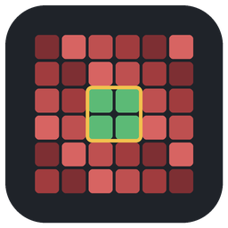

<p align="center">
  
</p>

<h1 align="center">ZomboidChunkReset</h1>

<p align="center">
  <b>Reset chunks of Project Zomboid Build 42 saves: keep your base, let the game regenerate the rest.</b><br>
  A desktop tool in the spirit of MCASelector, for single-player and dedicated-server saves.
</p>

<p align="center">
  <a href="https://github.com/3zmana/zomboid-chunk-reset/releases/latest"></a>
  <a href="https://github.com/3zmana/zomboid-chunk-reset/actions/workflows/build.yml"></a>
  <a href="https://github.com/3zmana/zomboid-chunk-reset/releases"></a>
  <a href="LICENSE"></a>
  <br>
  
  
  
  
</p>

<p align="center">
  <a href="#-download">Download</a> ·
  <a href="#-quick-start">Quick start</a> ·
  <a href="docs/USER_GUIDE.md">User guide</a> ·
  <a href="docs/DELETION_RULES.md">Deletion rules</a> ·
  <a href="CHANGELOG.md">Changelog</a>
</p>

---

Added new mods that bring buildings, loot or map content, but your world was generated before? Delete the
chunks the game has already saved, and it generates them again, with your mods, the next time someone
walks there. ZomboidChunkReset shows your save on a map, lets you pick what to protect (your base, a
friend's house…) and resets everything else, or exactly the area you select.

> [!WARNING]
> **This program deletes files from your save, and deleted files cannot be recovered. Always work on a
> copy of the save, or make a backup first.** Close the game, or stop the server, before editing its
> save.
>
> The program never makes backups itself. Instead it reminds you to work on a copy at every start, asks
> for an explicit confirmation (with a box to tick) before every deletion, warns when Project Zomboid
> seems to be running, never modifies `players.db`, and leaves the save consistent even if a deletion is
> cancelled.

## ✨ Features

- 🗺️ **A real map of your save**: roads, water, grass, trees, roofs and walls, tile by tile, read from the
  save itself (no game files needed), with zoom, panning, cell borders and players.
- 🖱️ **Selection** with the mouse (rectangles, whole cells, deselection), by in-game coordinates, select
  all, invert, clear, undo/redo.
- 🧹 **Two actions**: delete the selection, or keep it and delete everything else.
- 🧟 Optional reset of **zombie and animal populations, iso regions and vehicles**, following
  [rules verified on real saves](docs/DELETION_RULES.md).
- 🔍 **Live preview, simulation**, confirmation, progress with cancellation.
- 📍 Coordinates under the mouse: chunk, cell and in-game X/Y, as on the in-game map.
- 💾 **Export and import of selections** (JSON), to reuse protected areas from one save to another.
- 🌐 English and French interface; other languages can be added as simple text files.

## 📦 Download

Get the latest version from the [Releases](https://github.com/3zmana/zomboid-chunk-reset/releases/latest)
page. Java is included: nothing else to install.

| System | File | How to run |
|---|---|---|
| Windows 10/11 (64-bit) | `ZomboidChunkReset-<version>-windows-x64.zip` | Extract it and run `ZomboidChunkReset.exe`. The program is not signed: if SmartScreen warns, choose *More info* > *Run anyway*. |
| Linux (x86-64) | `ZomboidChunkReset-<version>-x86_64.AppImage` | Make it executable (`chmod +x`) and run it. |

## 🚀 Quick start

1. **File > Open save…** and choose one save folder, for example
   `Zomboid/Saves/Multiplayer/<server name>` (or drop the folder on the window).
2. Select your base on the map (left drag), or with **Edit > Select by coordinates…** using in-game
   coordinates.
3. Choose **Keep the selected chunks, delete all the others**. The map is tinted red where chunks will
   be deleted and green where they are protected.
4. Check the preview, and **Simulate** if you want the exact list of what would be deleted.
5. **Delete…**, confirm, and let the program scan the save again.

The [user guide](docs/USER_GUIDE.md) explains every option, and what happens in game afterwards.

## 📚 Documentation

| Document | Content |
|---|---|
| [User guide](docs/USER_GUIDE.md) | Installing, the map, selecting, deleting, troubleshooting |
| [Deletion rules](docs/DELETION_RULES.md) | Exactly which files are deleted or changed, and why |
| [Save format](docs/SAVE_FORMAT.md) | The Build 42 save format, as verified on real files |
| [Development](docs/DEVELOPMENT.md) | Building, tests, packaging, CI, releases |
| [Changelog](CHANGELOG.md) | What changed in each version |

## 🛠️ Building from source

Requires JDK 21; everything else is downloaded by Gradle.

```
./gradlew test                  # tests (gradlew.bat on Windows)
./gradlew :app:run              # run from source
./gradlew :app:packageWindows   # Windows zip (on Windows)
./gradlew :app:packageLinux -Pappimagetool=/path/to/appimagetool   # AppImage (on Linux)
```

GitHub Actions builds both packages on every push and attaches them to a draft release for tags `v*`.
See [DEVELOPMENT.md](docs/DEVELOPMENT.md).

## ⚠️ Known limitations

- Build 42 saves only (verified on world version 249).
- Global objects (crops, traps, campfires…), basements and safehouse/faction records are stored in
  global files that are not modified: entries in reset areas may remain.
- Running-game detection is a heuristic and cannot see a server running on another machine.
- Tiles added by mods are drawn in a neutral grey on the map.

Found a problem? [Open an issue](https://github.com/3zmana/zomboid-chunk-reset/issues).

## 🙏 Credits

The layout of the chunk content, used only to draw the map, follows the description published by the
[pzdataspec](https://github.com/cff29546/pzdataspec) project (MIT licence), checked on real saves. See
[THIRD-PARTY-NOTICES.md](THIRD-PARTY-NOTICES.md).

Project Zomboid is a game by The Indie Stone. This project is not affiliated with The Indie Stone and
does not contain any game file.

## 📄 License

Released under the [MIT License](LICENSE).
